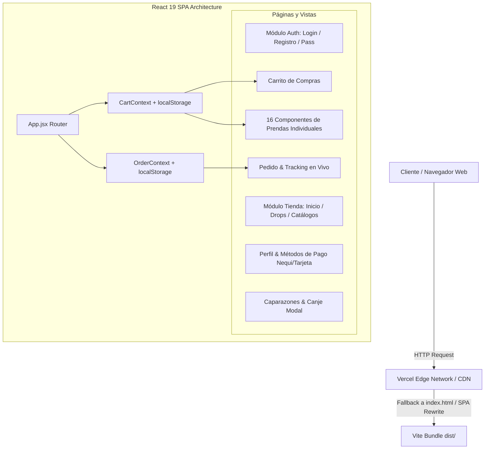

# TURTLE INC — Single Page Application (SPA)

> Proyecto e-commerce de moda urbana desarrollado en **React 19** y **Vite**, refactorizado a partir de la maqueta web estática de referencia (`html-referencia/TURTLE_INC-guti`), manteniendo al 100% la identidad visual, paleta de colores, tipografías y funcionalidades interactivas.

---

## 📌 Tabla de Contenidos
1. [Descripción del Proyecto](#-descripción-del-proyecto)
2. [Arquitectura e Infraestructura](#-arquitectura-e-infraestructura)
   - [Diagrama de Arquitectura de la SPA](#diagrama-de-arquitectura-de-la-spa)
   - [Infraestructura de Despliegue en Vercel](#infraestructura-de-despliegue-en-vercel)
3. [Estructura del Proyecto](#-estructura-del-proyecto)
4. [Módulos y Componentes Implementados](#-módulos-y-componentes-implementados)
   - [Autenticación y Cuentas](#1-autenticación-y-cuentas)
   - [Catálogo y Navegación](#2-catálogo-y-navegación)
   - [Prendas Individuales (16 Componentes)](#3-prendas-individuales-16-componentes)
   - [Carrito y Checkout Interactivo](#4-carrito-y-checkout-interactivo)
   - [Seguimiento de Pedidos](#5-seguimiento-de-pedidos)
   - [Sistema de Recompensas (Caparazones)](#6-sistema-de-recompensas-caparazones)
   - [Gestión de Perfil y Medios de Pago](#7-gestión-de-perfil-y-medios-de-pago)
5. [Instalación y Ejecución Local](#-instalación-y-ejecución-local)
6. [Guía de Despliegue en Vercel](#-guía-de-despliegue-en-vercel)
7. [Créditos del Proyecto](#-créditos-del-proyecto)

---

## 📖 Descripción del Proyecto

**TURTLE INC** es una marca y plataforma de comercio electrónico orientada a jóvenes y adultos que buscan autenticidad, confort y presencia en su estilo diario.

Esta refactorización transforma 38 archivos HTML planos y más de 20 hojas de estilo independientes en una **Single Page Application (SPA) modular, escalable y lista para producción**, utilizando:
- **React 19**: Componentes funcionales, React Hooks (`useState`, `useContext`, `useSearchParams`, `useNavigate`).
- **React Router 7**: Enrutamiento declarativo del lado del cliente sin recargas de página.
- **Vite 8**: Servidor de desarrollo con Hot Module Replacement (HMR) ultra veloz y empaquetador Rollup optimizado para producción.
- **Context API & Web Storage**: Gestión de estado reactiva y persistente en `localStorage` para el carrito y los pedidos.

---

## 🏗️ Arquitectura e Infraestructura

### Diagrama de Arquitectura de la SPA



### Infraestructura de Despliegue en Vercel

```mermaid
flowchart LR
    Dev[Repositorio Git / Local] -->|git push o vercel deploy| VercelBuild[Vercel CI/CD Build Engine]
    VercelBuild -->|npm install && vite build| DistFolder[dist/ Assets Generados]
    DistFolder -->|Deploy Global| EdgeNetwork[Global Edge CDN (HTTPS, Brotli/Gzip)]
    EdgeNetwork -->|Client-Side Routing| Rewrites[vercel.json Rewrites /* -> /index.html]
    Rewrites --> EndUser((Usuario Final))
```

#### Configuración de Infraestructura en `vercel.json`:
Para garantizar que rutas dinámicas y anidadas (ej. `/prendas/masculinas`, `/seguimiento`, `/producto/camisaprueba1`) no devuelvan error 404 al recargar el navegador, se incluye la regla de rewrite:
```json
{
  "rewrites": [
    {
      "source": "/(.*)",
      "destination": "/index.html"
    }
  ]
}
```

---

## 📁 Estructura del Proyecto

```text
mi-proyecto-react/
├── html-referencia/               # Carpeta original estática (HTML, CSS e imágenes)
├── public/                        # Activos públicos estáticos servidos en raíz (imágenes de prendas)
│   ├── camisa h (2).png
│   ├── buso v 1.png
│   ├── tenis 4.png
│   └── ...
├── src/
│   ├── components/                # Componentes comunes y reutilizables
│   │   ├── Header.jsx             # Encabezado degradado amarillo-verde
│   │   ├── Navbar.jsx             # Barra de navegación con buscador y badge de carrito
│   │   ├── Footer.jsx             # Pie de página institucional
│   │   ├── Layout.jsx             # Layout común para páginas de tienda
│   │   └── ProductDetailView.jsx  # Maqueta modular de detalle de prenda
│   ├── context/                   # Estado global con React Context
│   │   ├── CartContext.jsx        # Carrito dinámico sincronizado con localStorage
│   │   └── OrderContext.jsx       # Gestión de pedidos y estados de seguimiento
│   ├── data/                      # Base de datos local estructurada
│   │   └── products.js            # Metadata de las 16 prendas y próximos drops
│   ├── pages/                     # Vistas principales de la aplicación
│   │   ├── Login.jsx              # Vista inicial (index.html original)
│   │   ├── RegistroUsuario.jsx    # Formulario completo de registro de usuario
│   │   ├── OlvidasteContrasena.jsx# Envío de código de recuperación
│   │   ├── NuevaContrasena.jsx    # Actualización de clave
│   │   ├── Inicio.jsx             # Home / Bienvenida a la tienda
│   │   ├── UltimosDrops.jsx       # Catálogo de lanzamientos futuros
│   │   ├── Caparazones.jsx        # Sistema de puntos de fidelización
│   │   ├── CaparazonesCanje.jsx   # Canje interactivo de recompensas con modal
│   │   ├── Prendas.jsx            # Selector de Colección Masculina / Femenina
│   │   ├── PrendasMasculinas.jsx  # Grilla de 8 prendas masculinas
│   │   ├── PrendasFemeninas.jsx   # Grilla de 8 prendas femeninas
│   │   ├── MedidasHombre.jsx      # Tabla y guía de medidas masculina
│   │   ├── MedidasMujer.jsx       # Tabla y guía de medidas femenina
│   │   ├── Carrito.jsx            # Carrito con cantidades, eliminación y total
│   │   ├── Pedido.jsx             # Formulario de despacho y confirmación
│   │   ├── Seguimiento.jsx        # Tracking en tiempo real con botón interactivo
│   │   ├── Perfil.jsx             # Perfil de usuario y enlaces de pago
│   │   ├── MetodoActual.jsx       # Visualización de tarjeta Nequi
│   │   ├── IngresarTarjeta.jsx    # Registro de tarjeta con validación
│   │   ├── EliminarMetodo.jsx     # Confirmación de borrado de método de pago
│   │   ├── Verificar.jsx          # Verificación de código de seguridad
│   │   ├── Pago.jsx               # Checkout directo
│   │   ├── Busqueda.jsx           # Búsqueda en tiempo real (🐢)
│   │   └── products/              # 16 COMPONENTES INDIVIDUALES DE PRENDAS
│   │       ├── CamisaPrueba1.jsx
│   │       ├── BuzoHombre.jsx
│   │       ├── BuzoOscuroHombre.jsx
│   │       ├── ZapatosHombre.jsx
│   │       ├── ConjuntoHombre.jsx
│   │       ├── GorraBlanca.jsx
│   │       ├── PantalonetaCasual.jsx
│   │       ├── GafasHombre.jsx
│   │       ├── TopMujerPrueba.jsx
│   │       ├── BuzoRosaMujer.jsx
│   │       ├── BuzoOversizeMujer.jsx
│   │       ├── ChaquetaMujer.jsx
│   │       ├── FaldaMujer.jsx
│   │       ├── JoggerMujer.jsx
│   │       ├── TopBlanco.jsx
│   │       └── VestidoDeBano.jsx
│   ├── styles/                    # Estilos CSS organizados y desacoplados
│   │   ├── common.css             # Tipografía, header, navbar, footer, reset
│   │   ├── auth.css               # Tarjetas de login y registro
│   │   ├── catalog.css            # Grillas de productos y categorías
│   │   ├── product-detail.css     # Galería de imágenes, tallas y beneficios
│   │   ├── cart.css               # Filas del carrito, botones + / -, total
│   │   ├── order.css              # Formulario de pedido y barra de tracking
│   │   ├── profile.css            # Perfil, tarjetas de pago y avisos
│   │   ├── caparazones.css        # Puntos de recompensa y modal
│   │   └── medidas.css            # Tablas de guía de tallas
│   ├── App.jsx                    # Configuración de rutas de React Router
│   ├── main.jsx                   # Punto de entrada de la aplicación
│   └── index.css                  # Normalización de estilos base
├── index.html                     # HTML raíz con fuentes Google Fonts (Luckiest Guy & Poppins)
├── vercel.json                    # Reglas de enrutamiento para Vercel
├── vite.config.js                 # Configuración de Vite
└── package.json                   # Dependencias y scripts
```

---

## 🧩 Módulos y Componentes Implementados

### 1. Autenticación y Cuentas
- **Ruta `/` (Login)**: Página de inicio por defecto según requerimiento del proyecto (`index.html` original). Incluye validación de campos, opción de recordar sesión y enlaces de recuperación.
- **Ruta `/registro`**: Formulario estructurado para alta de nuevos usuarios con aceptación de términos.
- **Rutas `/olvidaste-contrasena` y `/nueva-contrasena`**: Flujo completo de recuperación mediante código y actualización de clave.

### 2. Catálogo y Navegación
- **Ruta `/inicio`**: Bienvenida oficial a la tienda con descripción de marca y accesos directos.
- **Buscador interactivo (🐢)**: Permite ingresar cualquier término en la barra superior y filtrar productos en tiempo real (`/buscar?q=...`).
- **Ruta `/ultimos-drops`**: Exhibición de prendas con etiqueta de "PRÓXIMAMENTE".
- **Rutas `/prendas`, `/prendas/masculinas`, `/prendas/femeninas`**: Navegación por colecciones con cards responsivas.

### 3. Prendas Individuales (16 Componentes)
Cada una de las prendas posee su propio componente React independiente dentro de `src/pages/products/`:
1. `CamisaPrueba1.jsx`: Camiseta Oversize Turtle Inc.
2. `BuzoHombre.jsx`: Buzo Turtle Inc oliva.
3. `BuzoOscuroHombre.jsx`: Camisa manga larga.
4. `ZapatosHombre.jsx`: Zapatos urbanos con tallas de calzado.
5. `ConjuntoHombre.jsx`: Buzo y sudadera combinada.
6. `GorraBlanca.jsx`: Gorra blanca bordada.
7. `PantalonetaCasual.jsx`: Pantaloneta deportiva y casual.
8. `GafasHombre.jsx`: Gafas de sol polarizadas.
9. `TopMujerPrueba.jsx`: Top corto acanalado.
10. `BuzoRosaMujer.jsx`: Buzo rosa pastel.
11. `BuzoOversizeMujer.jsx`: Buzo beige oversize.
12. `ChaquetaMujer.jsx`: Chaqueta moderna con forro.
13. `FaldaMujer.jsx`: Falda acampanada verde esmeralda.
14. `JoggerMujer.jsx`: Jogger deportivo de tiro alto.
15. `TopBlanco.jsx`: Top blanco esencial.
16. `VestidoDeBano.jsx`: Traje de baño de dos piezas.

Todos los componentes cuentan con selección interactiva de tallas, galería de 4 imágenes, enlace a la guía de medidas correspondiente (`/medidas/hombre` o `/medidas/mujer`) y botón funcional **"AGREGAR AL CARRITO"**.

### 4. Carrito y Checkout Interactivo
- **Ruta `/carrito`**: Conectado a `CartContext`.
  - Precargado con los 2 productos de muestra originales (`Camiseta Turtle INC` y `Top mujer Turtle INC`).
  - Permite modificar cantidades (`+` / `-`), eliminar ítems (`×`) y recalcular el subtotal y total automáticamente con formato de moneda colombiana (`$ COP`).
  - Sincronización continua con `localStorage` bajo la clave `carritoTurtle`.
  - Badge numérico en la barra de navegación que refleja la cantidad real de prendas agregadas.

### 5. Seguimiento de Pedidos
- **Ruta `/pedido`**: Captura dirección de entrega, teléfono de contacto, notas adicionales y preferencias de tracking.
- **Ruta `/seguimiento`**: Lee los datos del pedido registrado y presenta una barra de progreso interactiva (Preparado → En camino → Entregado) con animación de pulso. Incluye el botón **"Confirmar que ya llegó 🐢"** que activa el estado final y modal de entrega exitosa.

### 6. Sistema de Recompensas (Caparazones)
- **Ruta `/caparazones`**: Explica el programa de puntos de TURTLE INC y la escala de descuentos (25%, 50%, 75%, 99%).
- **Ruta `/caparazones/canjear`**: Interfaz de canje con modal emergente interactivo que confirma la obtención del beneficio.

### 7. Gestión de Perfil y Medios de Pago
- **Ruta `/perfil`**: Información del usuario y accesos de configuración.
- **Rutas `/metodo-actual`, `/ingresar-tarjeta`, `/eliminar-metodo`, `/verificar`, `/pago`**: Gestión de tarjetas (Nequi / crédito / débito), verificación por código SMS y confirmación de pago.

---

## 🚀 Instalación y Ejecución Local

### Prerrequisitos
- **Node.js**: versión 18 o superior recomendada.
- **npm** o gestor de paquetes equivalente.

### Pasos
1. Clonar o abrir la carpeta del proyecto:
   ```bash
   cd mi-proyecto-react
   ```
2. Instalar las dependencias:
   ```bash
   npm install
   ```
3. Ejecutar el servidor de desarrollo local:
   ```bash
   npm run dev
   ```
   Abre [http://localhost:5173](http://localhost:5173) en tu navegador para ver la aplicación funcionando.

4. Verificar calidad de código (ESLint):
   ```bash
   npm run lint
   ```

5. Compilar para producción:
   ```bash
   npm run build
   ```

6. Previsualizar la versión de producción:
   ```bash
   npm run preview
   ```

---

## ☁️ Guía de Despliegue en Vercel

El proyecto está 100% optimizado y listo para ser desplegado en **Vercel**:

### Opción 1: Mediante Vercel CLI
1. Instalar la CLI si no la tienes:
   ```bash
   npm i -g vercel
   ```
2. Ejecutar dentro de la carpeta del proyecto:
   ```bash
   vercel
   ```
3. Seleccionar las opciones predeterminadas (detecta automáticamente **Vite**).
4. Para desplegar directamente a producción:
   ```bash
   vercel --prod
   ```

### Opción 2: Mediante Git (GitHub / GitLab / Bitbucket)
1. Sube tu código a un repositorio de GitHub:
   ```bash
   git add .
   git commit -m "Refactorización completa SPA React y Vite"
   git push origin main
   ```
2. Ingresa a [Vercel](https://vercel.com) e inicia sesión.
3. Haz clic en **"Add New..." > "Project"**.
4. Importa el repositorio `Mi-proyecto-react`.
5. Verifica la configuración detectada:
   - **Framework Preset**: `Vite`
   - **Build Command**: `npm run build`
   - **Output Directory**: `dist`
6. Haz clic en **"Deploy"**. Vercel compilará la aplicación y te asignará una URL pública con certificado SSL HTTPS automático.

---

## 👥 Créditos del Proyecto

- **Marca & Diseño Original**: TURTLE_INC (Grado 11 Mediatic - Juan Pablo Múnera Toro & Valeri Sofía Sánchez Carvajal).
- **Refactorización a SPA**: Ingeniero de Software Frontend experto en React & Vite.
